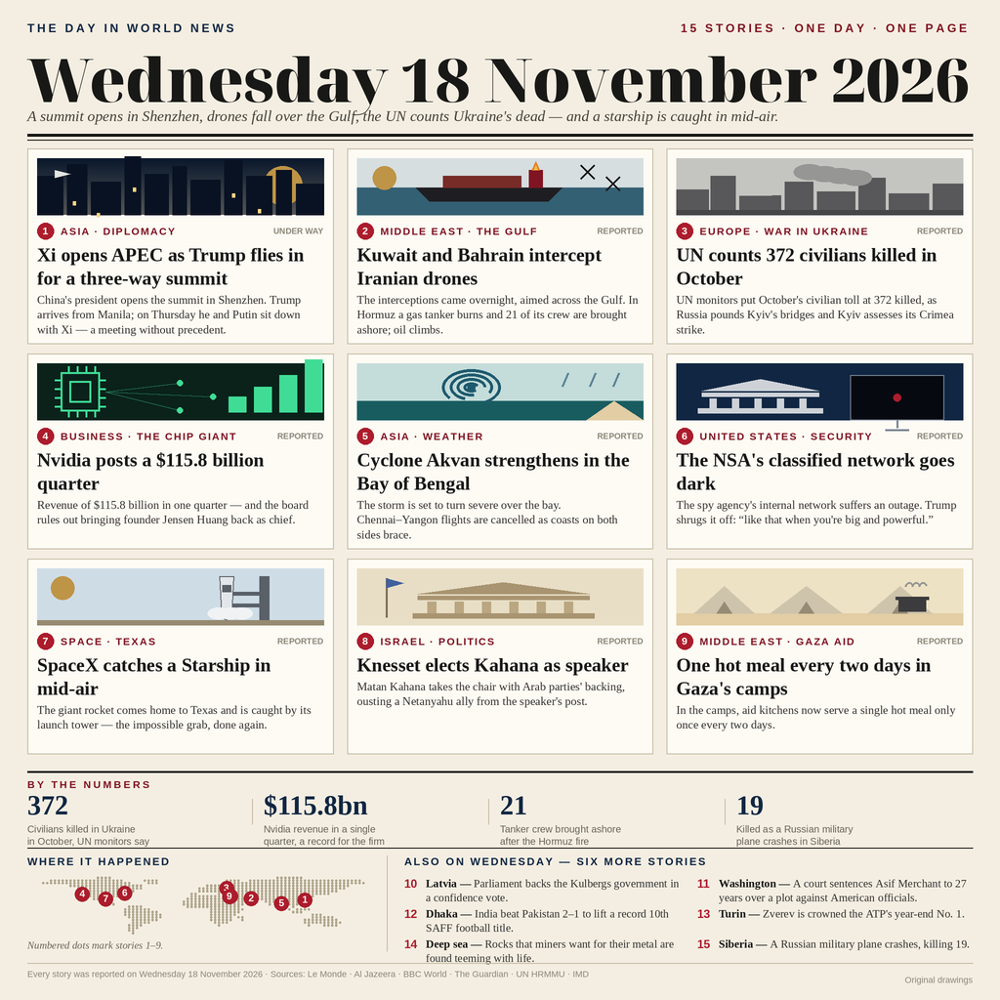

# news-image-20261118

[](https://make.fun/bounty/news-image-20261118?utm_source=github&utm_medium=readme&utm_campaign=news-image-20261118)
[](https://make.fun/bounty/news-image-20261118/leaderboard?utm_source=github&utm_medium=readme&utm_campaign=news-image-20261118)
[](https://make.fun/bounty/news-image-20261118?utm_source=github&utm_medium=readme&utm_campaign=news-image-20261118)

One image summing up the world news of **Wednesday 18 November 2026**,
entered in make.fun's `news-image-20261118` competition.



## What's on the page

- **Lead — Shenzhen:** Xi Jinping opens the APEC summit in Shenzhen;
  Donald Trump flies in from Manila ahead of Thursday's three-way
  meeting with Xi and Vladimir Putin.
- **The Gulf:** Kuwait and Bahrain intercept Iranian drones; a gas
  tanker burns in Hormuz and 21 crew are brought ashore; oil climbs.
- **Ukraine:** UN monitors count 372 civilians killed in October.
- **Business:** Nvidia posts $115.8 billion of quarterly revenue; its
  board rules out Jensen Huang's return as chief executive.
- **Weather:** Cyclone Akvan strengthens over the Bay of Bengal.
- **United States:** the NSA's classified internal network goes down.
- **Space:** SpaceX catches a returning Starship in mid-air.
- Briefs: Israel's new Knesset speaker, Latvia's confidence vote,
  Gaza aid kitchens, a U.S. sentencing, India's SAFF title, Zverev's
  year-end No. 1, deep-sea life, and the Siberia plane crash.

Every item was reported on 18 November 2026 (Le Monde, Al Jazeera,
ABC Australia, BBC World, the Guardian's live coverage, UN HRMMU
figures carried on the wires, the India Meteorological Department's
warnings, and Gizmodo's space reporting, all dated that day).

## How it is built

- `frontpage.py` — draws the current (round-2) edition with Pillow:
  a broadsheet front page with a serif masthead naming the day, nine
  numbered story cards with flat-illustration strips, a "by the
  numbers" strip, a dotted world map with pins for the card stories,
  and a numbered index of six more stories — fifteen stories in all.
  Drawn at twice size and downscaled; real fonts throughout, so no
  text is garbled, and the output is byte-for-byte deterministic.
- `make_image.py` — the round-1 drawing script, kept for the record.
- `entry.png` — the rendered picture (1024×1024, ~428 KB).
- `main.py` — the entry program (Python 3.13, standard library only).
  It validates `entry.png` against the gate (PNG, ≤ 1 MiB,
  ≤ 1024×1024), copies it byte for byte to the output directory and
  prints its SHA-256, so both grader runs write identical bytes.

Run it the way the grader does:

```sh
mkdir -p out && MAKEFUN_OUTPUT_DIR=out python3 main.py
```

Redraw the picture with `python3 frontpage.py` (needs Pillow; the
entry program itself needs nothing beyond the standard library).

## License

MIT — see `LICENSE`.
